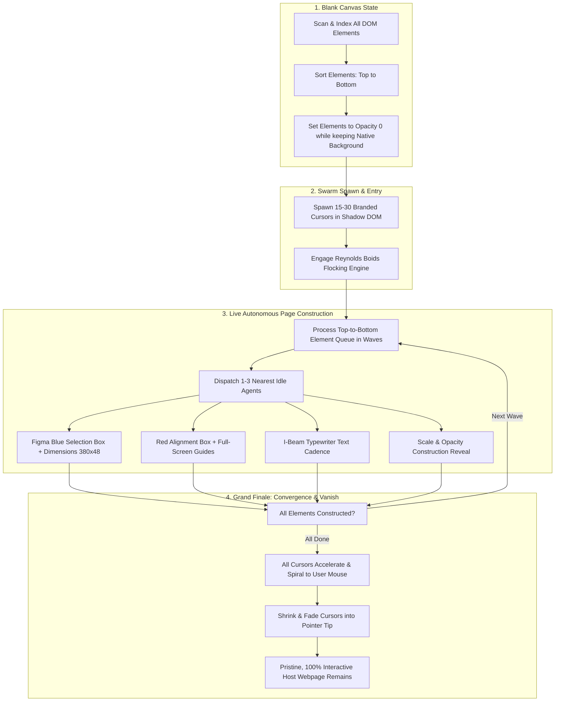
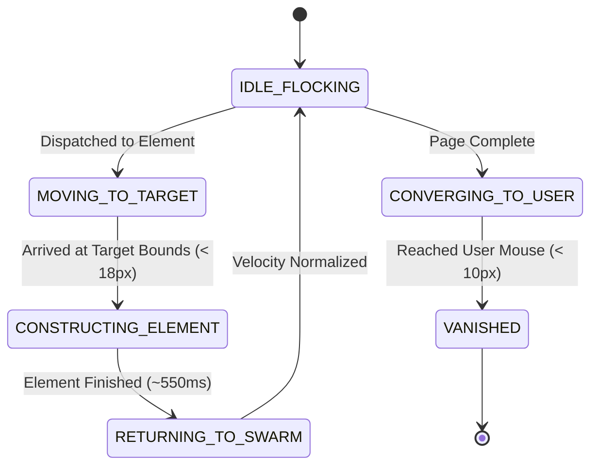

# `dom-swarm` Architecture & System Design

This document details the internal design, mathematical physics engine, rendering pipeline, and lifecycle management of `dom-swarm`.

---

## 1. High-Level Architecture Overview

`dom-swarm` is engineered as a zero-dependency, self-contained visual engine that non-destructively reverse-engineers any host webpage's DOM tree. When dropped into any website, it executes a complete 4-stage visual journey:

---

## 2. Autonomous Multi-Agent State Machine

Each agent in the swarm operates as an independent autonomous entity governed by a 6-state lifecycle:

1. **`IDLE_FLOCKING`**:
   - The agent participates in the collective Reynolds Boids flocking simulation.
   - Orbits dynamically around the user's active cursor or touch position.
   - Rotates along its velocity vector: `transform: translate3d(x, y, 0) rotate(deg) scale(1)`.

2. **`MOVING_TO_TARGET`**:
   - The agent is assigned to a specific target DOM coordinate (e.g., top-left corner, bottom-right handle, or center of an element).
   - Steers directly towards the target with arrival damping.
   - If the element is a pure text node (`p`, `h1`-`h6`, `code`), morphs icon to an `I-beam` text cursor.

3. **`CONSTRUCTING_ELEMENT`**:
   - The agent locks directly onto its assigned corner handle or edge of the bounding box (`tl`, `br`, `tr`, `bl`, or `ibeam`).
   - Active scroll tracking keeps the cursor rigidly anchored to the element's live `getBoundingClientRect()` coordinates every frame.
   - For block elements, multiple agents grip the 4 corners (`tl`, `br`, `tr`, `bl`), visibly dragging and holding the bounding box into place.
   - For text nodes, the agent morphs into a colored `I-beam` and advances along the text baseline during character typing.

4. **`RETURNING_TO_SWARM`**:
   - Construction concludes, bounding boxes dissolve, and the agent receives an impulse steering it back toward the flock cloud to be ready for the next queue task.

5. **`CONVERGING_TO_USER`**:
   - Fired when all elements in the build queue have completed.
   - All agents accelerate toward the live coordinates of the user's mouse (`mousePos`).
   - A tangential swirling force is applied to create an inward spiral.
   - Scale and opacity interpolate down as distance closes in:
     $$\text{scale} = \min\left(\frac{d}{70}, 1\right), \quad \text{opacity} = \min\left(\frac{d}{70}, 1\right)$$

6. **`VANISHED`**:
   - When within 10px of the user cursor tip, the agent disappears completely (`display: none; opacity: 0;`).
   - Once all agents are `VANISHED`, the swarm triggers `onSwarmVanished?.()`.

---

## 3. Reynolds Boids Physics Engine

The idle behavior is governed by Craig Reynolds' classic flocking model augmented with dynamic mouse attraction and soft boundary dampening:

1. **Separation ($F_s$):**
   Steers agents away from nearby flockmates within radius $r_{sep}$ to prevent crowding:
   $$F_s = \sum_{j \neq i} \frac{P_i - P_j}{\|P_i - P_j\|^2}$$

2. **Alignment ($F_a$):**
   Matches heading with neighboring flockmates within flocking radius $r_{flock}$:
   $$F_a = \left( \frac{1}{N} \sum_{j=1}^N V_j \right) - V_i$$

3. **Cohesion ($F_c$):**
   Attracts agents toward the local center of mass:
   $$C = \frac{1}{N} \sum_{j=1}^N P_j \quad \Longrightarrow \quad F_c = \text{seek}(P_i, C)$$

4. **Dynamic Mouse Orbit & Attraction ($F_m$):**
   When the user moves the mouse or taps the screen, a combined radial pull and tangential swirl force is exerted:
   $$F_m = F_{\text{seek}}(\text{mouse}) \cdot w_{\text{attract}} + F_{\text{tangent}} \cdot w_{\text{orbit}}$$

5. **Convergence Spiral ($F_{conv}$):**
   During the grand finale, agents seek the mouse with an amplified tangential swirl:
   $$F_{\text{conv}} = \text{seek}(P_i, \text{mouse}, 50) + \text{tangent}(P_i, \text{mouse}) \cdot 1.4$$

---

## 4. Non-Destructive DOM Isolation

`dom-swarm` guarantees zero visual and CSS bleeding:
- **Open Shadow DOM (`<dom-swarm-overlay>`):**
  Mounted with `position: fixed; inset: 0; pointer-events: none; z-index: 2147483647;`.
- **Zero Layout Shifts (CLS 0.00):**
  Hidden elements retain their exact computed geometry in the layout flow (`opacity: 0; transform: scale(0.96); pointer-events: none;`). The site's background, containers, and borders remain stable.
- **Instant Failsafe Restoration:**
  Every modified element has an exact inverse restoration function stored in an active registry. Calling `.destroy()` instantly restores all host elements to their pristine native styles.
- **Replay Capability (`.replay()`):**
  Re-applies the blank canvas hiding, resets cursors across the screen, and restarts the construction waves from the top.
